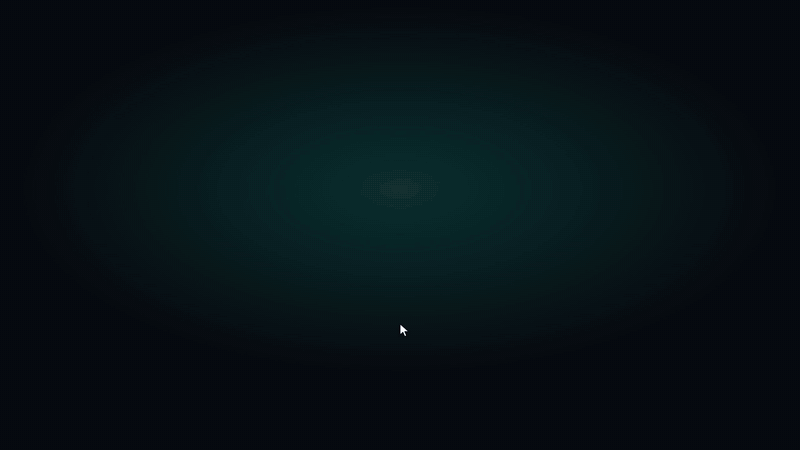

# make-demo

A [Claude Code](https://claude.com/claude-code) skill that makes product demos of the app you're building. It records the **real app** with a **Playwright script** and **checks the frames** before anything ships. One recording produces three formats:



<sub>Recorded from [`examples/todo-app`](examples/todo-app) by this skill · [MP4](docs/demo.mp4) · [interactive tour](https://davenc.dev/make-demo/tour.html)</sub>

| Format | Output | Use it for |
|---|---|---|
| **MP4** | `demo.mp4` | Portfolio sites, LinkedIn, Slack, launch posts. 60 fps, 1080p, best quality per MB. |
| **GIF** | `demo.gif` | Inline in READMEs, issues and PRs. |
| **Interactive tour** | `tour.html` | A single self-contained page: viewers click highlighted hotspots to step through real screenshots with captions. |

## Install

**As a plugin** (inside Claude Code):

```
/plugin marketplace add daven-c/make-demo
/plugin install make-demo@make-demo
```

**Or as a plain skill:**

```bash
git clone https://github.com/daven-c/make-demo.git
cp -R make-demo/skills/make-demo ~/.claude/skills/
```

Then ask Claude for "a demo of this app", "a README GIF" or "a product tour". You can also invoke `/make-demo` directly.

### Requirements

- Node 18+ and [`playwright`](https://playwright.dev) (added to your project as a dev dependency)
- `ffmpeg` / `ffprobe` (`brew install ffmpeg`)
- Google Chrome, if your app plays H.264/AAC media. Playwright's bundled Chromium can't decode it; set `DEMO_CHANNEL=""` to use Chromium anyway.

## What the skill does

1. **Plans a 30–60 s story** of 3–5 beats, picking inputs that give impressive and *correct* results, with content that is safe to publish.
2. **Scripts the recording** from [`record_demo.template.mjs`](skills/make-demo/scripts/record_demo.template.mjs). It gives the recording launch-video polish: 60 fps capture at 2x, an arrow cursor gliding on eased arcs, click ripples, smooth camera zooms towards the action, animated captions and title cards. It also does real mouse clicks (so overlays behave like they do for users), human-paced typing, and a screenshot plus hotspot at every click for the tour.
3. **Verifies frame by frame** with [`contact_sheet.sh`](skills/make-demo/scripts/contact_sheet.sh), which tiles the video into one image to catch frozen media, cold-cache blank cards and dialogs caught mid-animation.
4. **Encodes** with [`encode.sh`](skills/make-demo/scripts/encode.sh): a 60 fps H.264 MP4 plus a palette-optimised GIF. It warns if the GIF is over 10 MB.
5. **Builds the tour** with [`build_tour.mjs`](skills/make-demo/scripts/build_tour.mjs) as one HTML file with inlined images, keyboard navigation, progress dots and light/dark themes.

The full playbook, including the pitfalls it learned the hard way, is in [`SKILL.md`](skills/make-demo/SKILL.md).

## Using the scripts without Claude

The scripts are standalone and have no dependencies beyond Playwright and ffmpeg:

```bash
cp skills/make-demo/scripts/record_demo.template.mjs your-app/scripts/record-demo.mjs   # edit STEPS
DEMO_URL=http://localhost:5173 node your-app/scripts/record-demo.mjs   # → demo-out/raw.mp4 + demo-out/tour/
bash skills/make-demo/scripts/contact_sheet.sh demo-out/raw.mp4      # → demo-out/sheet.png
bash skills/make-demo/scripts/encode.sh demo-out/raw.mp4 docs/       # → docs/demo.mp4, docs/demo.gif
node skills/make-demo/scripts/build_tour.mjs demo-out/tour docs/tour.html --title "MyApp tour"
```

## Try the example

```bash
cd examples/todo-app
npm install
node serve.mjs &          # http://localhost:5173
node record-demo.mjs      # add DEMO_CHANNEL="" if Google Chrome isn't installed
```

Then run the contact sheet, encode and tour commands above on `examples/todo-app/demo-out/`. CI runs this same pipeline on every push and uploads the outputs as a build artifact.

## Layout

```
.claude-plugin/          plugin + marketplace manifests
skills/make-demo/
  SKILL.md               the skill Claude follows
  scripts/               recorder template, contact sheet, encoder, tour builder
examples/todo-app/       a tiny app with a filled-in recorder
docs/                    the demo above (GIF, MP4, tour) — also served by GitHub Pages
```

## License

[MIT](LICENSE)
